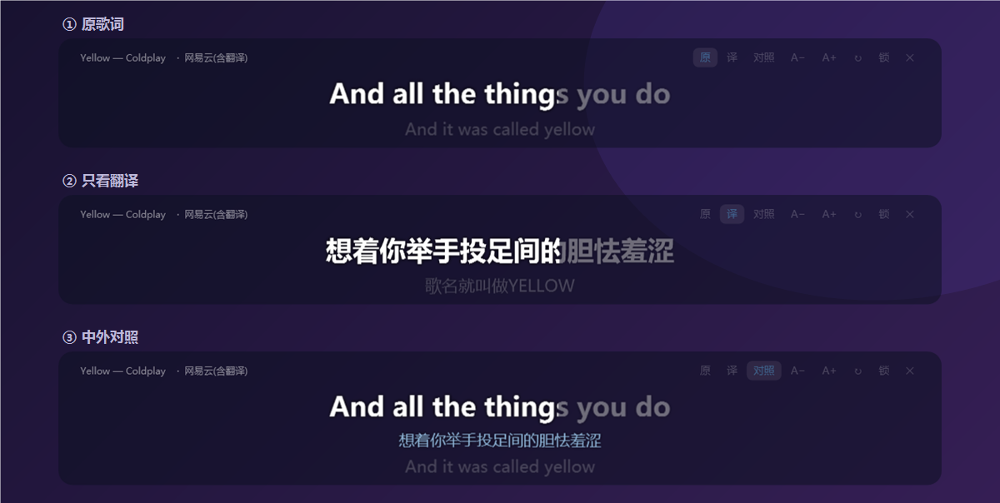

# 🎵 Spotify 桌面歌词（Windows）

给 Spotify 用的桌面歌词浮窗。仿酷狗桌面歌词：置顶、半透明、可拖动、**锁定后鼠标穿透**，逐字扫光；
**原歌词 / 中文翻译 / 中外对照** 三种模式一键切换，外文歌自动匹配现成翻译，冷门歌可以接 AI 翻译。



- 纯 PowerShell + WPF，**不需要安装 Python / Node / Electron**，Windows 10 / 11 自带环境直接跑
- 播放进度来自系统媒体控制（SMTC），**不接管播放器、不需要登录 Spotify、不碰你的账号**
- 歌词和翻译全部在本地请求公开接口，程序不上传任何数据

## 🚀 快速开始

1. 下载本仓库（右上角 **Code → Download ZIP**）并解压到任意目录
2. 先打开 **Spotify** 播一首歌（桌面版或网页版都行）
3. 双击 **`启动桌面歌词.vbs`** —— 不弹黑框，1~2 秒后歌词条出现在屏幕底部
4. 用完点右上角 **✕** 退出

> 双击没反应或被浏览器/杀软拦下：右键 `启动桌面歌词.vbs` → 属性 → 勾选「解除锁定」再试；
> 或者双击 **`调试运行.bat`**，它会带控制台启动，报错直接显示出来。

## 🎛 操作

| 控件 / 操作 | 作用 |
| --- | --- |
| **原** | 只显示原歌词 |
| **译** | 只显示中文翻译（没有翻译时退回原文并提示） |
| **对照** | 原文 + 译文对照（默认） |
| **A− / A+** | 缩小 / 放大字号（鼠标滚轮也行） |
| **↻** | 丢弃缓存，重新抓这首歌的歌词 |
| **锁** | 锁定：整条歌词变成鼠标穿透，不挡你点桌面 |
| **Ctrl+Alt+L** | 全局快捷键，锁定 / 解锁（锁定时唯一的出口） |
| 拖动歌词区 | 移动位置（自动记住） |
| 双击歌词 | 在 原 → 译 → 对照 之间循环 |
| 右键 | 菜单：模式 / 字号 / 重新抓歌词 / 锁定 / 退出 |

锁定后按钮会隐藏，左上角显示 `… · 🔒 已锁定，Ctrl+Alt+L 解锁`，歌词继续滚动但鼠标可以直接点到后面的窗口。

## 🌍 歌词和翻译从哪来

程序本身**不含任何歌词**，全部在你本机实时获取：

1. **公开歌词接口** —— 取带时间轴的原文，有现成中文翻译就一并取回
2. **备用歌词库** —— 上面找不到的歌，再换一个库找
3. **AI 翻译** —— 都没有翻译时，把整首歌词一次性发给 AI，结果缓存在本地，同一首歌只翻译一次

### 让第 3 步生效（可选）

编辑 `config.json`：

```json
"ai": {
  "enabled": true,
  "apiKey": "sk-你的key",
  "baseUrl": "https://api.deepseek.com",
  "model": "deepseek-chat"
}
```

或者不填文件，改成设置环境变量 `DEEPSEEK_API_KEY`，启动时会自动读取。
接口是 OpenAI 兼容格式（`{baseUrl}/chat/completions`），换成别的服务只要改 `baseUrl` 和 `model`。

> 不填 key 也完全能用：热门外文歌直接用现成的中文翻译，只有冷门歌才会提示「未找到翻译」。

## ⚙️ 配置项 `config.json`

| 字段 | 说明 |
| --- | --- |
| `mode` | 启动时的模式：`original` / `translation` / `both` |
| `fontSize` | 主歌词字号，默认 34；`A+ / A−` 会写回这里 |
| `windowWidth` | 歌词条宽度，默认 1120（按 2048 宽的屏调的，可自己改） |
| `panelOpacity` | 底板不透明度 0~1，设成 `0` 就是**无底板**的纯文字歌词 |
| `windowOpacity` | 整个窗口的不透明度 |
| `x` / `y` | 位置，`-1` = 屏幕底部居中；拖动后自动写入 |
| `showNextLine` | 是否显示下一句预览 |
| `syncOffset` | 时间轴偏移（秒），比如 `-0.5` 表示歌词整体延后半秒 |
| `netease` / `lrclib` | 是否启用对应歌词源 |
| `alwaysOnTop` | 是否永远置顶 |

改完配置需要重启程序（✕ 退出后再双击启动）。

## ❓ 常见问题

**Q：一直显示「没有找到这首歌的歌词」？**
公开歌词库里只有纯文本、没有时间轴，或者根本没收录。点 **↻** 重试，或换个版本播放。

**Q：歌词比人声快 / 慢半拍？**
不同版本的歌词时间轴偶尔会差一点。把 `config.json` 里 `syncOffset` 调成 `-0.3` / `+0.3` 之类的值再重启。

**Q：匹配到的不是我听的版本？**
匹配是按 歌名 + 歌手 + 时长 打分的，同名翻唱/Remix 可能撞车，表现为时间轴对不上。点 **↻** 删缓存重抓，或换一个版本播。

**Q：锁定了怎么解锁？**
按 **Ctrl+Alt+L**。如果这个组合被别的软件占了，任务管理器结束 `powershell.exe` 也能解锁（窗口会一起关掉）。

**Q：Spotify 网页版能用吗？**
能。程序优先抓 Spotify 客户端的会话，没有的话会找浏览器里正在播放、且带歌手信息的会话。

**Q：多显示器？**
默认放在主屏底部；拖到副屏后位置会被记住，但换分辨率/拔显示器可能跑到屏幕外，删掉 `config.json` 里的 `x`/`y` 改回 `-1` 即可。

## 🗂 目录结构

```
SpotifyLyrics/
├─ 启动桌面歌词.vbs        ← 平时双击这个
├─ 调试运行.bat            ← 出问题时双击，带控制台
├─ config.json             ← 配置（模式 / 字号 / AI Key / 位置）
├─ screenshots/modes.png
├─ src/SpotifyLyrics.ps1   ← 主程序
├─ cache/                  ← 歌词缓存（可删）
└─ logs/app.log            ← 运行日志
```

## ⚖️ 版权与免责

- 本项目是第三方工具，与 Spotify 及任何歌词平台均无关联，也未获其授权或背书。
- 仓库内**不包含任何歌词文本**；README 截图中的示例为公有领域儿歌与作者自译，仅作界面演示。
- 歌词与翻译的版权归原权利人所有。程序只在用户本机实时请求公开接口并显示，不存储副本、不重新分发、不提供下载。
- 仅供个人学习与自用，请勿将歌词内容用于商业用途或二次分发。
- 若权利人认为本项目不当，请开 Issue 联系，收到通知后会移除相关功能。
- 第三方接口随时可能变更，失效时欢迎提 Issue。

## 📄 License

[MIT](LICENSE)
